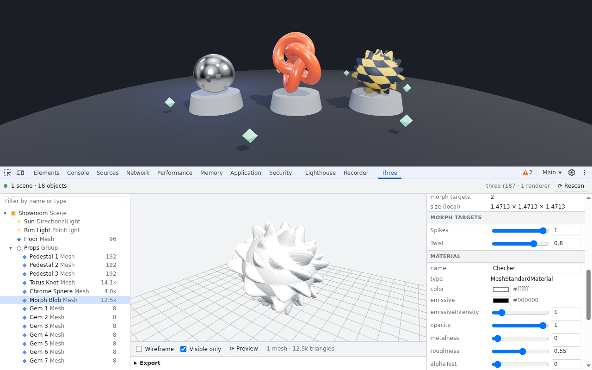

# Three Inspector

A Chrome DevTools panel for [three.js](https://threejs.org): browse the scene graph and tweak objects, materials and lights while the scene runs.


## Features

- **Scene graph**: every object in the scene, with a filter, visibility toggles and a blink to find objects on the page.
- **Live editing**: transforms, materials, lights, cameras, morph targets, background, fog, tone mapping, exposure and shadows.
- **Details**: geometry attributes and triangle counts, texture thumbnails, `userData` and renderer stats.
- **Preview**: any object or group on its own, with a wireframe mode.
- **Export**: the selection as STL or 3MF.

Works with three.js r110 and later, with `WebGLRenderer` and `WebGPURenderer`, and with scenes inside iframes.

<table>
  <tr>
    <td></td>
    <td></td>
  </tr>
  <tr>
    <td align="center">Morph targets</td>
    <td align="center">Lights</td>
  </tr>
</table>

## Install

1. Clone this repository.
2. Open `chrome://extensions`, turn on **Developer mode** and click **Load unpacked**.
3. Pick the repository folder.

## Usage

1. Open DevTools on a page that uses three.js and select the **Three** panel (it may be under `»`).
2. If the 3D view only renders when you interact with it, orbit or zoom once.
3. Click an object in the tree to see and edit its properties. Double-click it to make it blink on the page.

## How it works

Nothing runs until you open the panel. Then a small agent is added to the page and briefly patches a few functions that a rendering three.js app calls every frame (property lookups on `Object.prototype`, `Array.prototype.sort`, `Function.prototype.call`/`apply`). The first three.js object it sees leads to the scene, and every patch is removed right after. **Rescan** searches again.

The extension asks for no permissions, makes no network requests and collects no data. See [PRIVACY.md](PRIVACY.md).

## Development

```bash
cd test
npm install
npm run build          # test pages + sample models
npm run serve &        # 127.0.0.1:8701 and :8702
npm test               # drives the real DevTools panel on every test page
node screenshots.cjs   # regenerates store/screenshots
```

`scripts/package.sh` builds the zip for the Chrome Web Store. The listing texts are in [store/listing.md](store/listing.md).

## License

[MIT](LICENSE). Includes [three.js](https://github.com/mrdoob/three.js) (MIT) in `vendor/three`.
